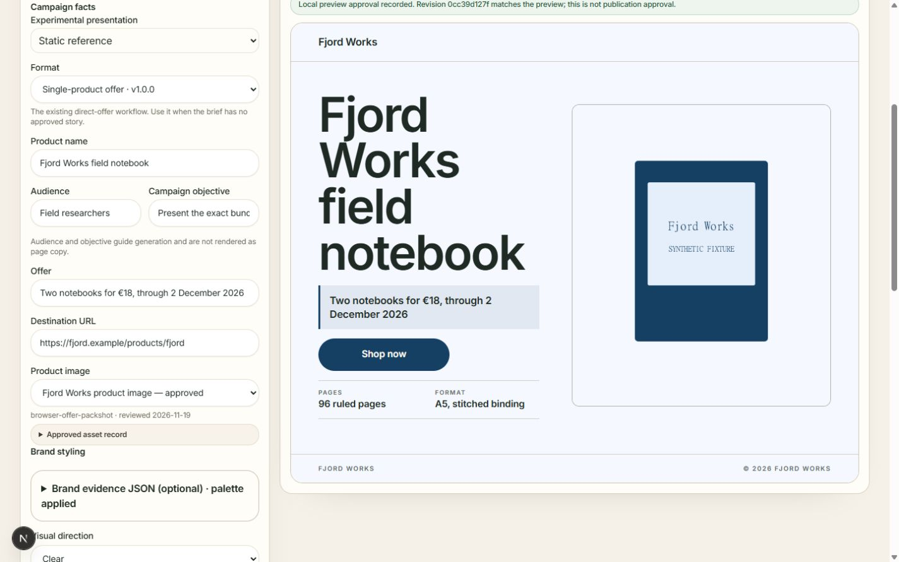
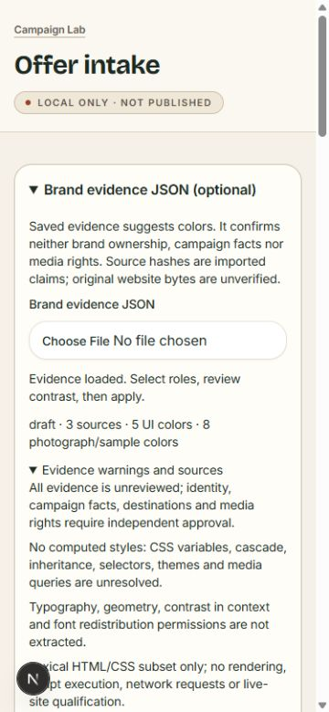
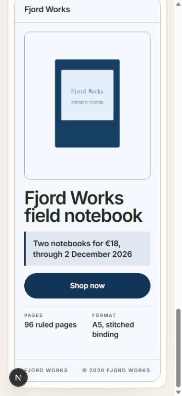

# Local review gallery

Root-agent-operated synthetic fixtures, 19 November 2026. Full journey, commands, assistance and limitations: [report](../../campaign-lab-brand-review.md).

Page viewport overrides were read back as **1440×900** and **375×812**. These normal-height screenshots contain the browser content area after scrollbar exclusion: **1425×891** and **360×780**. [Bitmap geometry](gallery/geometry.json). No tall capture is presented as a normal viewport.

## Desktop article inspection

Fjord invalid-output fallback, approved revision `0cc39d127f53fbca`. Article measured 909×736.23 at x466/y36.91 inside a 1440×900 page viewport after a 450px page scroll. Context is retained; this is not an article-only crop.

## Mobile evidence review

375×812 page viewport. Partial CSS/SVG findings and unreviewed rights remain separate from usable colors and from campaign attestations.

## Mobile keyboard focus and timeout fallback

375×812 page viewport, explicit accent override `#123456`, timeout fallback revision `e209038f6d26c17b`. Keyboard Tab reached the action with `:focus-visible` and a 3px ink outline. The page width was 360px; no horizontal overflow.

## Other normal-height captures

- [Rose editor, 1440×900](gallery/rose-editor-desktop.jpg)
- [Rose corrected approval details, 1440×900](gallery/rose-corrected-desktop.jpg)
- [Rose editor/approval context, 375×812](gallery/rose-editor-mobile.jpg)
- [Fjord editor, 1440×900](gallery/fjord-editor-desktop.jpg)
- [Fjord approved fallback details, 1440×900](gallery/fjord-approved-desktop.jpg)
- [Fjord editor, 375×812](gallery/fjord-editor-mobile.jpg)

Editorial assessment: coherent cool page/navy action and clear media/offer hierarchy. The long notebook name wraps to four desktop lines at this preview width. Rose's warm source palette and corrected Editorial appearance retain its exact offer. Expanded evidence is necessarily long on mobile. These agent-assisted synthetic checks do not establish independent customer usability or automatic brand fidelity.

The initial wrong-viewport capture, unsuccessful article crop and wrong-tab mobile override capture are preserved in ignored `.local/failed-gallery`. The `file:` export inspection was policy-blocked and not bypassed; portable package hashes/resources and HTML/receipt agreement were checked separately.
