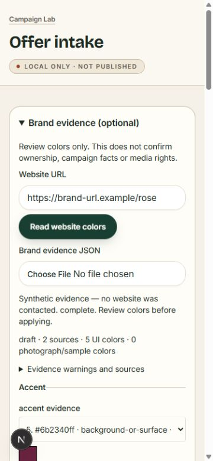
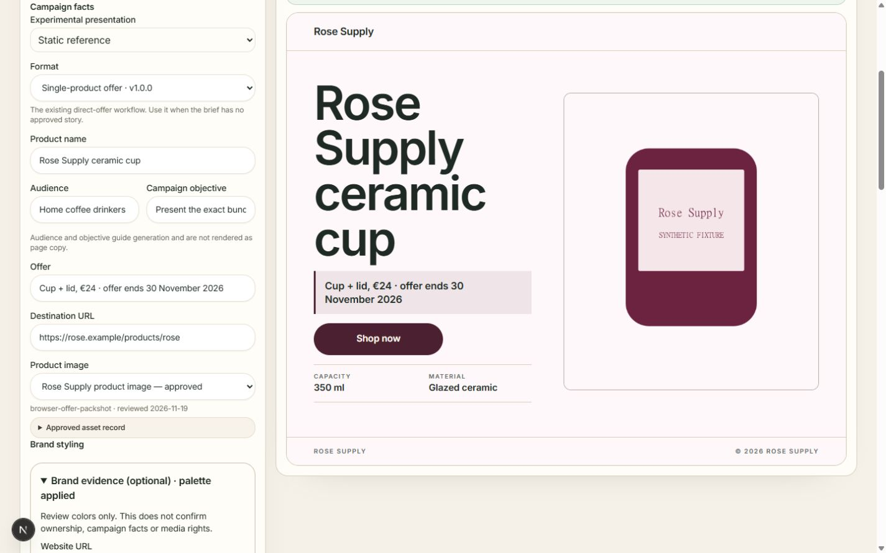
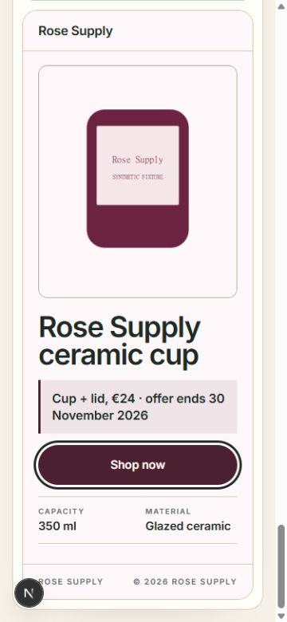

# URL evidence review gallery

Root-agent-operated synthetic Session 1. [Report and API contract](../../campaign-lab-brand-url.md).

DOM viewports were **1440×900** and **375×812**. Returned normal-height JPEGs are **1425×891** and **360×780** respectively; [bitmap geometry](geometry.json) records those separately. No tall capture substitutes for normal height.

## Mobile URL intake

URL and saved-file entry feed the existing picker. Synthetic origin is explicit; detailed warnings are collapsed.

## Approved corrected article

The same packshot and exact campaign terms remain. Translucent evidence was corrected, applied, regenerated and freshly approved.

## Mobile article and keyboard

Tab reached the CTA with focus-visible true and a 3px ink outline. Document width was 360 inside a 375×812 viewport. [Focus observation](keyboard-observation.json).

Other normal captures: [editor](gallery/editor-desktop.jpg), [URL retry in editor](gallery/url-review-desktop.jpg), [preview geometry](preview-observation.json).

Judgment: URL controls fit mobile, with source/correction details ahead of expandable caveats. The warm action/page works with the unchanged synthetic packshot. The inherited four-line heavy desktop title remains a composition tradeoff; factual copy was not rewritten. This does not establish real-brand fidelity or independent usability. Native direct-file playback remains unqualified and was not retried.
