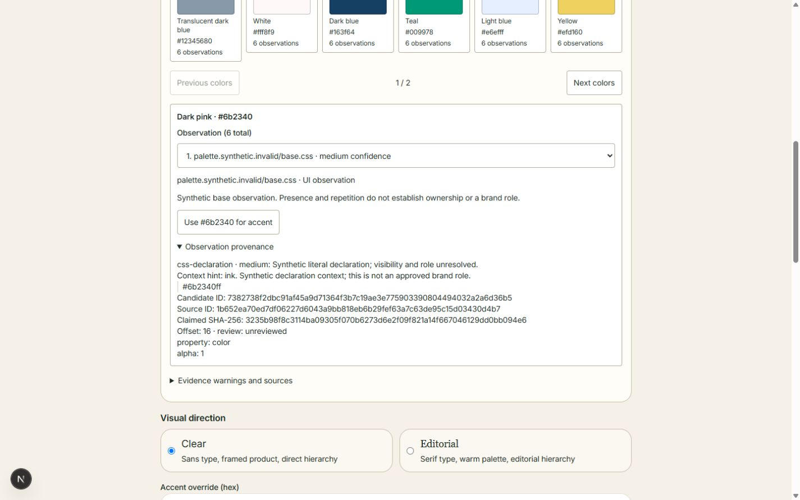
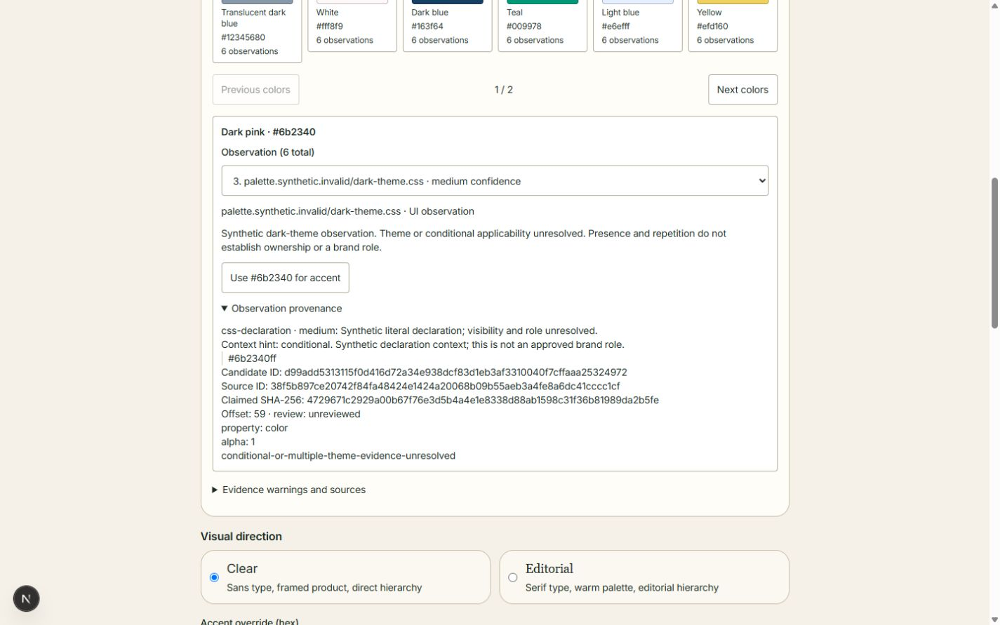
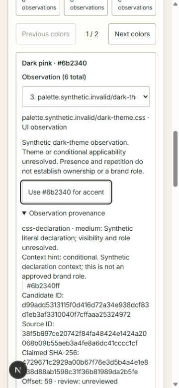

# Filter-to-observation interaction evidence

Before: clean `c699285`. After: runtime freeze `75eb498`. Both use the unchanged tracked synthetic large fixture through normal saved-evidence intake. No website request. JSON records read the native observation selector and rendered DOM, not React state.

| Action | Before inspected ID | After inspected ID |
| --- | --- | --- |
| Filter dark-theme.css, open #6b2340 | `7382738f2dbc91af45a9d71364f3b7c19ae3e775903390804494032a2a6d36b5` (base) | `d99add5313115f0d416d72a34e938dcf83d1eb3af3310040f7cffaaa25324972` (dark) |
| Search exact dark ID, open #6b2340 | same unrelated base ID | exact searched dark ID |

[Before source record](before-source.json), [before exact-ID record](before-exact-id.json), [after source record](after-source.json), [after exact-ID reopen](after-exact-id-reopen.json).

| Before source-filtered inspection | After matching inspection |
| --- | --- |
|  |  |

[Exact-ID search context before](before-exact-id.jpg), [after](after-exact-id.jpg). These context captures accompany the exact selected-ID records; they are not substitutes for those records.

Further actual interactions:

- Changing source while inspection stayed open changed inspection from [base](after-changed-base-open.json) to [dark](after-changed-dark-open.json).
- A contradictory exact-ID/source filter produced [no matching group/inspection](after-conflicting-source-query.json).
- [Explicit outside-filter selection](after-explicit-outside.json) kept all six observations accessible, marked the selected option `outside filters`, displayed an outside-filter status and changed the action to `Use outside-filter #6b2340 for accent`.
- [Use then Inspect selected](outside-use-inspect-selected.json) showed the genuine base ID. Changing to the exact-ID query [reconciled to dark](query-reconciles-explicit-selected.json), and [Use then Inspect selected](exact-id-use-inspect-selected.json) showed the dark ID.
- [No results](no-results-retains-choice.json), [clear](clear-retains-choice.json) and [failed replacement](failed-replacement-keeps-current.json) kept pending role choices.
- After Apply, [source filtering refreshed inspection to base](applied-filter-change-inspection-refresh.json), while [Inspect selected still showed the applied conditional source](applied-selected-source-preserved.json). The [receipt](receipt.json) retains that conditional candidate; browsing did not replace it.

Desktop screenshots requested 1440×900 and mobile 375×812. Native JPEG content sizes are recorded in capture-geometries.json; all are normal-height captures. This is agent-assisted implementation verification, not an independent customer usability study.
