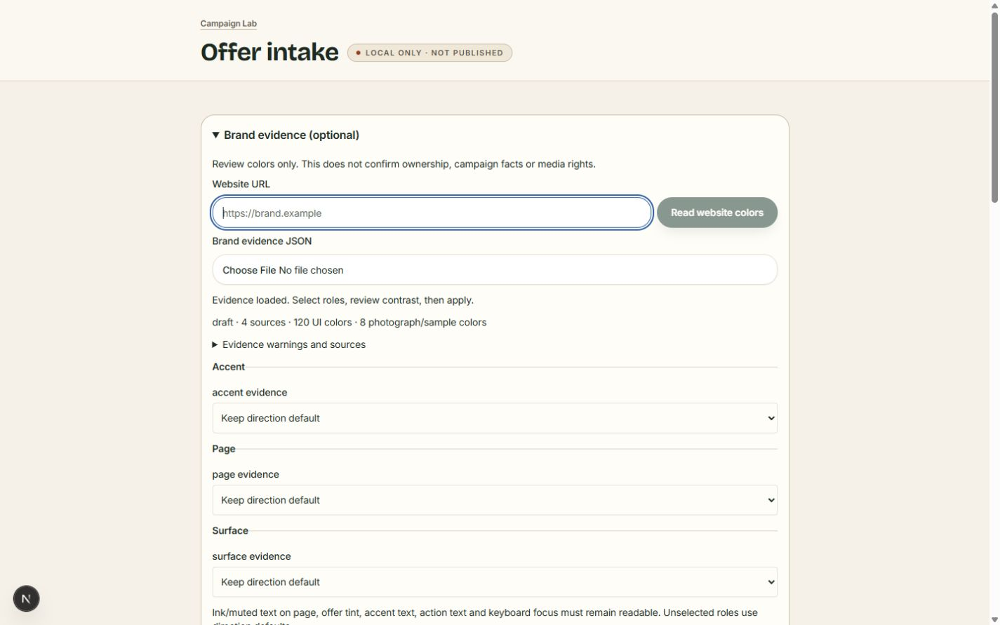
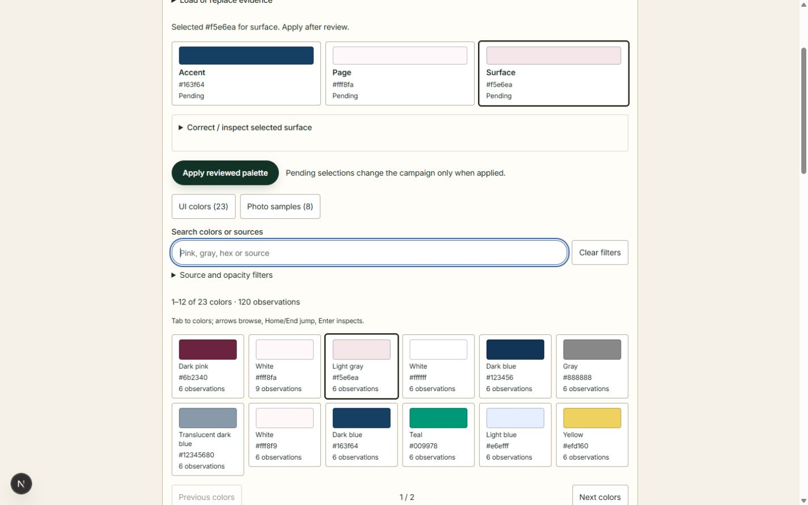
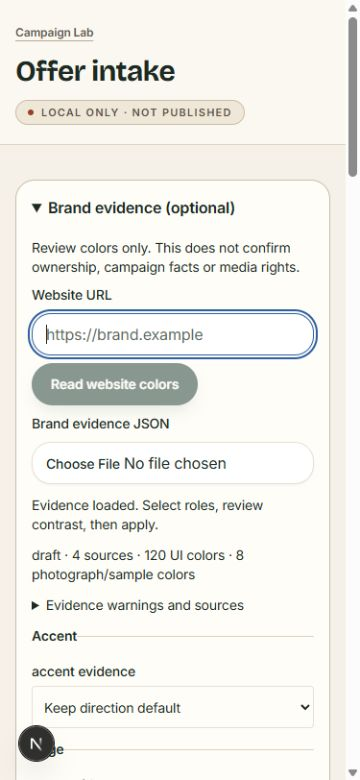
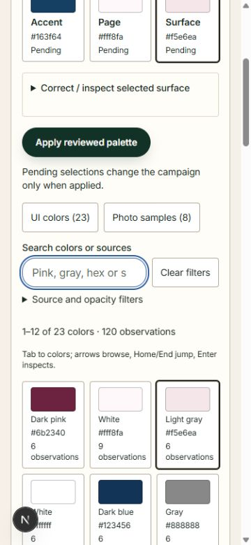
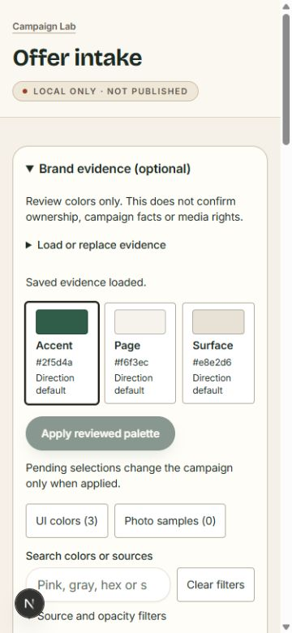
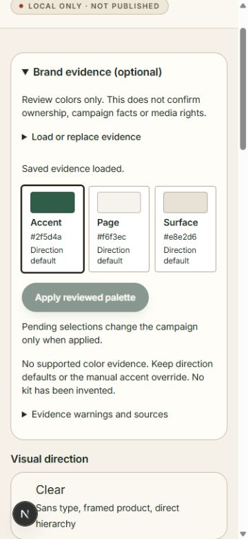

# Palette review: before and after

Same deterministic large saved-evidence fixture, no website requests. Baseline is `13b1e9a`; final review is `b079fbf`. The final examples show pending choices; they are not automatically applied. Captures use normal-height viewports with scrolling, not tall composite pages. Actual JPEG pixel sizes and requested browser dimensions are retained in [capture-geometries.json](capture-geometries.json).

| 1440 × 900 viewport: before | 1440 × 900 viewport: after |
| --- | --- |
|  |  |

The baseline has three color selectors with 129 options each (128 observations plus default). The new view separates 120 UI observations into 23 exact-color groups and eight photo observations into eight groups. Twelve groups are visible per page; all observations remain inspectable. Color counts are not brand-role rankings.

| 375 × 812 viewport: before | 375 × 812 viewport: after |
| --- | --- |
|  |  |

These are assisted implementation checks, not a timed usability experiment. Before captures have no pending role assignments; after captures show explicit pending assignments. Campaign input context is separately frozen for the complete journey.

| Small clean set | Insufficient set |
| --- | --- |
|  |  |

[No-result search](no-results.jpg) keeps pending selections. [Desktop approved appearance](final-preview-desktop.jpg) and [mobile approved appearance](final-preview-mobile.jpg) retain the existing generated-page design and original packshot.
